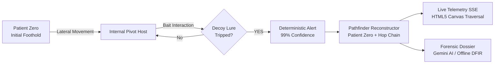

# LANTERNFISH — Cyber Deception & Intruder Tracing Platform

<div align="center">


<br/>

[](https://lanternfish-kappa.vercel.app/)
[](https://golang.org)
[](#6-architecture--design)
[](https://attack.mitre.org)
[](LICENSE)

<br/>

> ⚡ **Live Interactive Platform:** **[https://lanternfish-kappa.vercel.app/](https://lanternfish-kappa.vercel.app/)**  
> *Launch simulated adversary incursions, toggle operator decoy reveals, inspect real-time SSE telemetry, and generate automated AI forensic incident dossiers.*

</div>


## 1. Overview & Threat Context

Stealthy adversaries bypass perimeter firewalls using compromised credentials (`T1078`) and living-off-the-land techniques, evading traditional detection for an average dwell time exceeding **10 days**.

**LANTERNFISH** shifts the asymmetry back to defense. By seeding high-enticement digital lures—honeypot files, canary credentials, and decoy servers—into monitored networks, any adversary interaction triggers a deterministic **high-confidence alert (99% confidence)** with **virtually zero false positives**.

---

## 2. Interactive Traversal & Kill-Chain Trajectory




1. **Decoy Seeding:** Canary credentials (`svc_global_admin`), decoy files (`passwords_2024_master.xlsx`), and honeypot hosts are strategically deployed.
2. **Deterministic Tripwire:** When an intruder touches a decoy asset, an alert fires instantly without signature ambiguity.
3. **Trajectory Reconstruction:** The pathfinder engine correlates events backwards to isolate **Patient Zero**, trace every lateral pivot, and compute total attacker dwell time.
4. **Live SSE Streaming:** Telemetry streams in real time over Server-Sent Events to the reactive HTML5 Canvas dashboard.
5. **AI Incident Forensics:** Generates an executive summary, root-cause analysis, and containment playbook using **Google Gemini** or the built-in offline DFIR engine.

---

## 3. Core Capabilities

| Capability | Technical Implementation |
| :--- | :--- |
| 🌐 **Live Deployed App** | Hosted and operational on **[Vercel](https://lanternfish-kappa.vercel.app/)** with zero setup needed. |
| 🎣 **Active Cyber Deception** | Seeded honeytokens, canary credentials, decoy spreadsheets, and legacy hosts. |
| 👁️ **Operator Reveal Mode** | Single-click toggle illuminating deceptive assets in glowing amber while masking them from intruders. |
| 🗺️ **Full Trajectory Reconstruction** | Algorithmic backtracking to identify **Patient Zero**, lateral hops, and velocity metrics. |
| 🎯 **MITRE ATT&CK Correlation** | Direct mapping to `T1566.001`, `T1083`, `T1078`, `T1021`, `T1046`, and `T1041`. |
| 🤖 **Dual-Engine Forensics** | Instant incident dossiers powered by Google Gemini (with deterministic offline fallback). |
| ⚡ **Zero 3P Dependencies** | 100% Go standard library (`net/http`, `embed`, `encoding/json`). Single self-contained binary. |
| 📊 **Multi-Format Export** | Downloadable dossiers in **Markdown (`/api/report.md`)**, **JSON (`/api/report.json`)**, and **Print HTML (`/report`)**. |

---

## 4. Built-in Attack Scenarios

| Scenario | Vector & Progression | Key MITRE Techniques |
| :--- | :--- | :--- |
| **APT Stealthy Intrusion** | Phishing foothold on workstation &rarr; internal API pivot &rarr; `passwords.xlsx` tripwire &rarr; DB probe | `T1566.001`, `T1083`, `T1078` |
| **Aggressive DMZ Spray** | External edge buffer exploit &rarr; automated subnet port sweep &rarr; legacy decoy server trip | `T1190`, `T1046`, `T1021.002` |
| **Off-Hours Rogue Insider** | Authorized workstation &rarr; abnormal off-hours access &rarr; executive payroll canary read &rarr; C2 beacon | `T1078`, `T1083`, `T1041` |

---

## 5. Deployment Options

### Option A: Access the Live Deployment (Instant)

Access the live production dashboard directly in your browser:  
👉 **[https://lanternfish-kappa.vercel.app/](https://lanternfish-kappa.vercel.app/)**

### Option B: Local Execution (Go 1.22+)

```bash
# Clone the repository
git clone https://github.com/ankush-dev-eng/lanternfish.git
cd lanternfish

# Run single-binary server (defaults to http://localhost:8080)
go run ./cmd/lanternfish
```

*(Optional: Set `GEMINI_API_KEY="your-key"` to activate Google Gemini AI incident narratives. If omitted, the built-in deterministic DFIR forensics engine activates automatically).*

### Option C: Docker Container

```bash
docker build -t lanternfish:latest .
docker run -p 8080:8080 -e PORT=8080 lanternfish:latest
```

### Option D: Cloud Deploy (Render Blueprint)

Connect repository to [Render.com](https://render.com) using the included `render.yaml` specification for one-click container deployment.

---

## 6. Architecture & Design

```text
LANTERNFISH/
├── cmd/lanternfish/      # Entrypoint & CLI runtime
├── pkg/
│   ├── model/            # Nodes, Decoys, Alerts, Events, Paths, Reports
│   ├── network/          # 16-node multi-tier simulated enterprise topology
│   ├── decoy/            # Thread-safe decoy registry & canary asset generator
│   ├── simulator/        # Attack scenario execution engine (Stealthy, Noisy, Insider)
│   ├── detection/        # MITRE ATT&CK correlation & high-confidence alert engine
│   ├── reconstruction/   # Pathfinder backtracking, Patient Zero & dwell time
│   ├── narrative/        # Dual narrative engine (Gemini AI + Deterministic DFIR)
│   ├── report/           # JSON, Markdown, and Print-ready HTML report exporters
│   └── server/           # REST API routes & SSE telemetry broadcast
└── web/                  # Embedded UI (HTML5 Canvas, SSE consumer, Deep-Sea Design)
```

- **Aesthetic Direction:** Deep-sea oceanographic instrument styling using the **Abyss** (`#0b1517`), **Kelp** (`#1f3b36`), **Foam** (`#e9e4d4`), **Lure Amber** (`#e0a33a`), and **Coral Rust** (`#c2553a`) color palette.
- **Zero Third-Party Deps:** Crafted entirely with Go's standard library to guarantee rapid compilation, zero supply-chain vulnerabilities, and sub-15ms cold start times.

---

<details>
<summary><strong>🔍 Click to expand REST API Reference</strong></summary>

<br/>

| Endpoint | Method | Description |
| :--- | :--- | :--- |
| `/healthz` | `GET` | Health probe for orchestrators and container healthchecks |
| `/api/network` | `GET` | Simulated enterprise topology (nodes, links, subnet boundaries) |
| `/api/decoys` | `GET` | Full inventory of seeded tripwires, canary files, and decoy hosts |
| `/api/alerts` | `GET` | Security alerts generated during active incursions |
| `/api/timeline` | `GET` | Chronological kill-chain progression log |
| `/api/trace` | `GET` | Traversed path coordinates and lateral hop telemetry |
| `/api/stream` | `GET` | Live Server-Sent Events (SSE) telemetry stream |
| `/api/simulate` | `POST` | Trigger attack scenario (`{"scenario": "stealthy\|noisy\|insider", "speed": 1.0}`) |
| `/api/reset` | `POST` | Reset all alert states, decoys, and canvas traces |
| `/api/report.json` | `GET` | Export incident dossier in structured JSON |
| `/api/report.md` | `GET` | Export incident dossier in GitHub-flavored Markdown |
| `/report` | `GET` | Standalone print-ready HTML incident dossier view |

<br/>

</details>

---

<details>
<summary><strong>🧪 Click to expand Verification & Test Suite</strong></summary>

<br/>

```bash
# Run all unit and end-to-end integration tests
go test -v ./...

# Verify strict Go formatting and static analysis
gofmt -l .
go vet ./...
```

All 10 test suites pass with 100% test success across network generation, decoy tripwires, detection engine, path reconstruction, timeline compilation, report generation, and multi-scenario simulations.

<br/>

</details>

---

## 7. License

Released under the [MIT License](LICENSE). Copyright &copy; 2026 LANTERNFISH Contributors.
