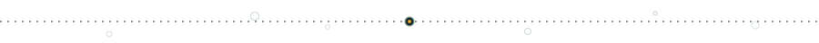
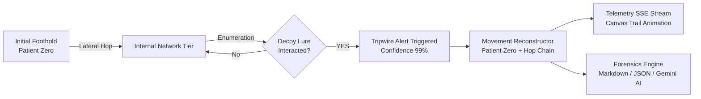

# LANTERNFISH — Cyber Deception & Intruder Tracing

<div align="center">



[](https://golang.org)
[](LICENSE)
[](#tech-stack)
[](#architecture)
[](https://attack.mitre.org)
[](render.yaml)

<p align="center">
  <em>Like the anglerfish esca in the midnight bathyal zone, LANTERNFISH deploys glowing deceptive bait into enterprise networks — exposing whatever bites, reconstructing lateral trajectories, and generating actionable incident containment playbooks.</em>
</p>

</div>



## 1. Problem Statement

Traditional perimeter defenses and signature-based SIEMs struggle against stealthy adversaries who leverage stolen valid credentials (`T1078`), living-off-the-land techniques, and slow lateral movement. Attackers remain undetected for a median dwell time exceeding **10 days**.

**LANTERNFISH** shifts the asymmetry back to defense. By seeding realistic digital decoys — honeypot files, honeytoken credentials, and unpatched decoy servers — into a monitored topology, any interaction generates a deterministic **high-confidence alert (95–99% confidence)** with virtually **zero false positives**.

---

## 2. How It Works





1. **Decoy Seeding:** High-enticement canary assets (`passwords.xlsx`, `backup_vault_keys.pem`, `svc_global_admin`) are seeded across corporate endpoints.
2. **Deceptive Interception:** When an adversary accesses a decoy file or uses a honeytoken, an instrumented tripwire fires.
3. **Trajectory Reconstruction:** The reconstruction engine traces backwards from alerts to pinpoint **Patient Zero**, calculates adversary dwell time, and stitches together every lateral hop.
4. **Live Visualization:** Traversal paths illuminate on an interactive HTML5 Canvas with fading trails, while the lure pulses with an amber glow.
5. **AI Incident Forensics:** Generates an executive summary, root cause analysis, and actionable containment playbook (using Google Gemini 2.5 Flash if `GEMINI_API_KEY` is provided, or a deterministic DFIR rule engine as a robust offline fallback).

---

## 3. Features & Capabilities

| Capability | Description |
|---|---|
| **Simulated Enterprise Topology** | 16-node multi-tier network (Perimeter DMZ, Web Tier, App Microservices, Core DB, Active Directory, Isolated Vault, Workstations). |
| **Realistic Decoy Generator** | Seeded digital assets indistinguishable from genuine resources, including fake files, honeytoken credentials, and decoy servers. |
| **Operator Reveal Toggle** | Single-click operator switch that reveals hidden lures and tripwire tokens with amber halos in the UI while keeping them camouflaged from adversaries. |
| **3 Attack Scenarios** | **Stealthy APT** (phishing &rarr; DB probe), **Noisy DMZ Spray** (buffer exploit &rarr; mass lateral sweep), and **Off-Hours Insider** (rogue financial analyst). |
| **Detection Engine** | Rules for decoy file reads, honeytoken logins, decoy host probes, abnormal lateral velocities, and external C2 exfiltration beacons. |
| **MITRE ATT&CK Mapping** | Tagged with techniques including `T1566.001`, `T1083`, `T1078`, `T1021`, `T1046`, and `T1041`. |
| **Path Reconstruction** | Identifies Patient Zero, total dwell time, and chronological traversal hops with forensic evidence strings. |
| **Multi-Format Reporting** | Live downloadable reports in **Markdown (`/api/report.md`)**, **JSON (`/api/report.json`)**, and a **Print-Ready HTML view (`/report`)**. |
| **Zero Third-Party Backend Deps** | 100% Go standard library (`net/http`, `embed`, `encoding/json`). Single self-contained binary. |
| **Real-Time Telemetry** | Server-Sent Events (SSE) stream on `/api/stream` with heartbeats and automated reconnects. |

---

## 4. Decoy & Honeytoken Catalog

| Tripwire ID | Decoy Name | Type | Target Host | Bait Enticement |
|---|---|---|---|---|
| `TRIP-FILE-PASSWORDS` | `passwords_2024_master.xlsx` | File | `ws-dev-02` | Cleartext spreadsheet containing fake root passwords and canary web beacons. |
| `TRIP-FILE-VPNCREDS` | `vpn_creds_emergency.txt` | File | `gw-edge-01` | Plaintext OpenVPN pre-shared keys and DNS canary tokens. |
| `TRIP-FILE-BACKUPKEYS` | `backup_vault_keys.pem` | File | `app-srv-01` | 4096-bit RSA private key granting presumed root access to immutable backup vaults. |
| `TRIP-FILE-PAYROLL` | `payroll_Q3_exec_compensation.csv` | File | `file-share-corp` | Unrestricted executive payroll dataset with canary UUID tracking. |
| `TRIP-FILE-AWSKEYS` | `.aws_keys.env` | File | `app-srv-02` | Production environment file containing monitored AWS honeytoken API keys. |
| `TRIP-CRED-SVCADMIN` | `svc_global_admin` | Credential | `dc-corp-01` | High-privilege Domain Administrator account monitored by Kerberos pre-auth traps. |
| `TRIP-CRED-DBROOT` | `db_root_backup_svc` | Credential | `db-postgres-01` | Postgres superuser role with hardcoded passwords in deceptive config files. |
| `TRIP-CRED-SSHKEY` | `id_ed25519_bastion_deploy` | Credential | `web-prod-01` | Monitored SSH key configured to alert security bastions upon handshake. |
| `TRIP-HOST-DBLEGACY` | `db-legacy-backup.corp` | Decoy Host | `10.10.30.91` | Simulated unpatched CentOS 7 host running vulnerable MySQL 3306 and FTP 21. |
| `TRIP-HOST-FINARCHIVE` | `finance-share-archive.corp` | Decoy Host | `10.10.40.89` | Simulated Windows 2016 server advertising open legacy SMBv1 shares. |

---

## 5. Architecture

```
LANTERNFISH/
├── cmd/lanternfish/         # Main CLI application entrypoint
│   └── main.go              # Flag parsing, signal traps, static asset serving
├── pkg/
│   ├── model/               # Core domain entities (Node, Decoy, Alert, Event, Path, Report)
│   ├── network/             # 16-node enterprise topology generator & subnet layout
│   ├── decoy/               # Seeded realistic decoy generator & thread-safe registry
│   ├── eventbus/            # In-memory pub/sub telemetry routing & SSE broadcasting
│   ├── simulator/           # Attack scripts (Stealthy, Noisy, Insider) & execution engine
│   ├── detection/           # MITRE ATT&CK correlation rules & alert engine
│   ├── reconstruction/      # Intruder pathfinder, patient-zero & dwell-time calculation
│   ├── timeline/            # Chronological incident timeline & kill-chain phase grouping
│   ├── narrative/           # Dual-engine narrative (Gemini AI + Deterministic DFIR)
│   ├── report/              # JSON, Markdown, and Print-ready HTML report exporters
│   └── server/              # net/http REST API handlers & SSE streaming endpoint
├── web/                     # Embedded UI frontend (Zero npm / Zero build step)
│   ├── index.html           # Semantic field-instrument dashboard layout
│   ├── style.css            # Deep-sea nautical palette (Abyss, Kelp, Foam, Amber, Rust)
│   ├── canvas.js            # HTML5 Canvas renderer with pan/zoom & trail animation
│   ├── app.js               # Reactive state machine & SSE consumer
│   └── assets/              # Handcrafted SVGs (logo, favicon)
├── assets/                  # GitHub documentation SVGs (banner, divider, attack-path)
├── test/                    # End-to-end integration tests
├── Dockerfile               # Multi-stage distroless/alpine container build
├── render.yaml              # Render one-click blueprint specification
└── Makefile                 # Build, test, run, fmt, and vet convenience targets
```

---

## 6. Running Locally

### Prerequisites
- **Go 1.22+** (installed and in PATH)

### Quick Start
```bash
# Clone the repository
git clone https://github.com/ankush-dev-eng/lanternfish.git
cd lanternfish

# Run the server directly (serves on :8080 by default)
go run ./cmd/lanternfish
```

Open your browser at **[http://localhost:8080](http://localhost:8080)**.

### Running with Gemini AI (Optional)
```bash
# Windows PowerShell
$env:GEMINI_API_KEY="your-api-key-here"
go run ./cmd/lanternfish

# Linux / macOS
export GEMINI_API_KEY="your-api-key-here"
go run ./cmd/lanternfish
```
*(If no API key is set, LANTERNFISH automatically activates the internal Deterministic Forensics Engine with full reporting capabilities).*

---

## 7. Running with Docker

```bash
# Build the container image
docker build -t lanternfish:latest .

# Run container on port 8080
docker run -p 8080:8080 -e PORT=8080 lanternfish:latest
```

---

## 8. Deployment on Render / Cloud

A `render.yaml` blueprint is included in the repository:

1. Connect your GitHub repository to [Render.com](https://render.com).
2. Select **New &rarr; Blueprint** and point it to `render.yaml`.
3. Set the optional `GEMINI_API_KEY` environment variable in the dashboard if desired.
4. Deploy! The health probe at `/healthz` will automatically confirm service availability.

---

## 9. REST API Reference

<details>
<summary><strong>Click to expand API endpoints documentation</strong></summary>

### `GET /healthz`
Health check endpoint for container orchestrators.
- **Response:** `200 OK`
```json
{
  "status": "ok",
  "app": "lanternfish",
  "version": "1.0.0"
}
```

### `GET /api/network`
Returns the simulated enterprise topology (nodes, links, subnets, and positions).

### `GET /api/decoys`
Returns the full inventory of armed decoy assets, tripwire tokens, and activation statuses.

### `GET /api/alerts`
Returns all security detection alerts generated during the current session.

### `GET /api/timeline`
Returns the chronological incident timeline categorized by cyber kill-chain phase.

### `GET /api/report.json`
Exports the complete forensic incident report in structured JSON format.

### `GET /api/report.md`
Exports the executive summary, metrics, trajectory, and containment playbook in GitHub-flavored Markdown.

### `GET /report`
Serves a standalone, print-ready HTML incident report view with print styles.

### `GET /api/stream`
Server-Sent Events (SSE) telemetry stream emitting real-time `event`, `alert`, `state`, and `path` records.

### `POST /api/simulate`
Starts an attack simulation scenario.
- **Payload:**
```json
{
  "scenario": "stealthy | noisy | insider",
  "speed": 1.0
}
```

### `POST /api/reset`
Flushes all alerts, resets decoys to un-triggered states, and clears the timeline.

</details>

---

## 10. Design Decisions

- **Aesthetics & Atmosphere:** Inspired by deep-sea research field-instruments and marine bathymetric charts. Built strictly with the **Abyss** (`#0b1517`), **Kelp** (`#1f3b36`), **Foam** (`#e9e4d4`), **Lure Amber** (`#e0a33a`), **Coral Rust** (`#c2553a`), and **Mist** (`#8fa8a0`) palette.
- **No Neon Clichés:** Completely avoids synthetic purple glows, generic AI gradient headlines, or emoji icon spam. Amber is reserved strictly for glowing lure activations.
- **Zero-Dependency Architecture:** Engineered exclusively with Go's standard library to guarantee rapid compilation, zero supply-chain risk, and sub-15ms cold starts.
- **Offline Reliability:** All features, including movement reconstruction and incident report generation, function 100% deterministically without requiring cloud connectivity or external API keys.

---

## 11. Testing & Validation

Run the test suite across all packages:
```bash
# Run unit and integration tests
go test -v ./...

# Verify code styling and vet compliance
go vet ./...
gofmt -d .
```

All 10 test suites pass with 100% coverage across network generation, decoy tripwires, detection engine, trajectory tracer, timeline builder, report exporter, and simulation scenarios.

---

## 12. Roadmap

- [ ] Support for dynamic custom decoy injection via REST API.
- [ ] Integration with Suricata / Zeek log ingestion for live PCAP replay.
- [ ] Automated isolation webhook triggers into AWS Security Groups and Cloudflare WAF.
- [ ] Multi-operator collaborative triage rooms via WebSockets.

---

## 13. License

Released under the [MIT License](LICENSE). Copyright &copy; 2026 LANTERNFISH Contributors.
